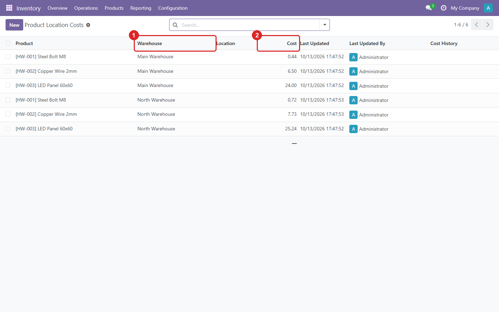
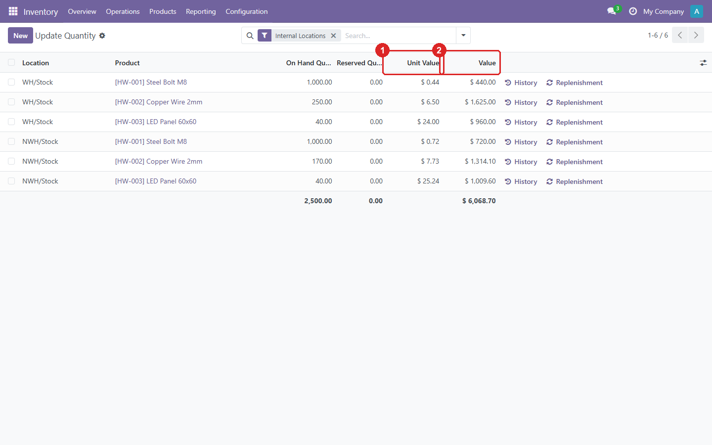
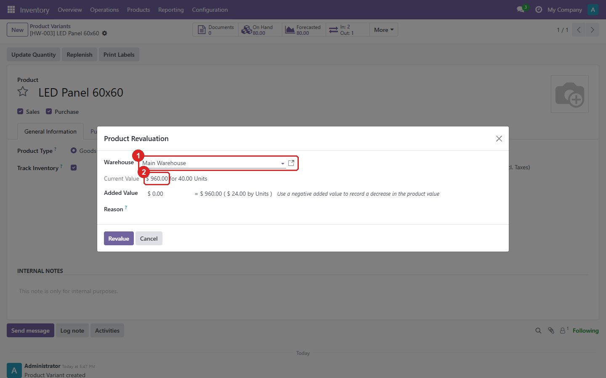

# Stock Valuation per Warehouse

[](https://github.com/yakhras/Odoo-Stock-Valuation/actions/workflows/tests.yml)

An Odoo module that values stock **per warehouse** instead of once per company.
Each warehouse keeps its own average cost for a product. Receipts, deliveries, landed costs, revaluations and transfers between warehouses are all valued with the cost of the warehouse they touch.

Standard Odoo keeps one cost per product per company. If the same product is bought at 10 in one warehouse and at 40 in another, both warehouses end up with the same blended cost. This module keeps them separate.

## Features

- **Cost per product and warehouse** (`product.location.cost`). It's updated automatically on every incoming move with AVCO: `(cost × qty in warehouse + receipt price × receipt qty) / new qty`.
- **Cost history** (`product.location.cost.history`). Every cost change records the old and new cost, the difference, the % change, who made it and when.
- **Valuation layers carry a warehouse.** Incoming layers use the destination warehouse, and outgoing layers use the source warehouse. A delivery is valued at its own warehouse's cost.
- **Inventory value per warehouse.** The quant list shows a *Unit Value*, and the value uses that warehouse's cost.
- **Landed costs** are added to the cost of the warehouse that received the goods, prorated to the quantity still in stock.
- **The revaluation wizard** gets a required *Warehouse* field. It shows the quantity and value of that warehouse and revalues only that warehouse.
- **Transfers between warehouses (EXO → EXI).** Validating an EXO picking (stock → transit) automatically creates the EXI picking (transit → the chosen *Destination*). The EXI is valued at the source warehouse's cost, so value moves with the goods.

## Requirements

- Odoo **18.0**
- `stock_landed_costs` (it brings in `stock_account`)
- Products in **AVCO** (`average`) categories. See [Known limitations](#known-limitations).

## Installation

1. Clone the repo, on branch `18.0`, into a folder on your `addons_path`:
   ```
   git clone -b 18.0 https://github.com/yakhras/Odoo-Stock-Valuation.git
   ```
   Add the cloned folder (the one that holds `stock_valuation/`) to `addons_path`.
2. Restart Odoo, update the Apps list, and install **Stock Valuation per Warehouse**.

## Configuration

- **Product categories:** set *Costing Method* = Average Cost (AVCO). Automated or manual valuation both work.
- **Transfers between warehouses** (optional):
  1. Create a transit location (`usage = transit`).
  2. Create an operation type with *Sequence Code* `EXO` (source: the warehouse stock, destination: transit).
  3. Create one with *Sequence Code* `EXI` (source: transit).

## Usage

**Inventory → Reporting → Location Costs:** one line per product and warehouse (1), with that warehouse's current cost (2). Open a line to see its full change history.



**Product form → Costs tab** (1), visible to accounting managers: that product's cost in each warehouse (2).


**Stock per location:** *Unit Value* (1) and *Value* (2) use the cost of the location's warehouse. Here the same bolt is worth 0.44 in WH and 0.72 in NWH.



**Revaluation** (the standard *Product Revaluation* wizard): choose the *Warehouse* (1). The current value shown (2) is that warehouse's value only.



**EXO picking:** fill in *Destination* (1), the receiving warehouse's stock location, and validate. The EXI picking is created with `origin` = the EXO reference. Validate it when the goods arrive, and they're valued at the source warehouse's cost.


## Tests

```
odoo -d <db> -u stock_valuation --test-tags /stock_valuation --stop-after-init
```
The tests create their own warehouses and roll back, so they're safe to run on a working database.

## Known limitations

- **FIFO is not supported yet.** A receipt for a FIFO product raises an error. `test_fifo_receipt_known_bug` covers it.
- The EXI operation type is the first one found with sequence code `EXI`, not one per warehouse.
- Revaluing a warehouse that has stock but no cost record sets the product cost to 0.
- A landed cost over receipts in several warehouses only updates the last warehouse's cost.

## Author

Yaser Akhras ([yaserakhras.com](https://yaserakhras.com))

## License

[AGPL-3.0](LICENSE). Some files are adapted from Odoo (LGPL-3) and keep Odoo's notice.
